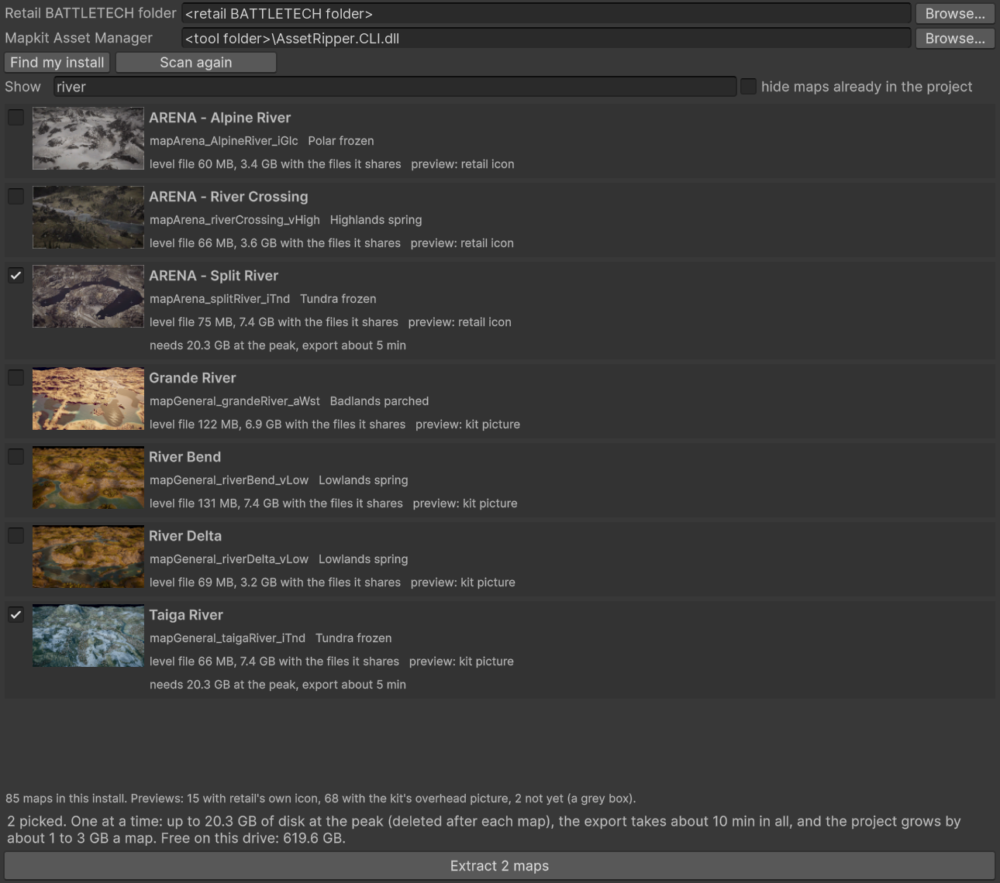
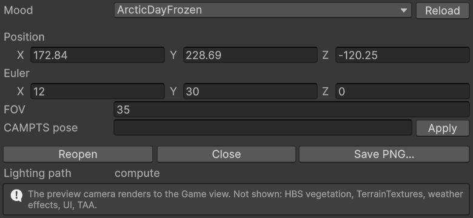
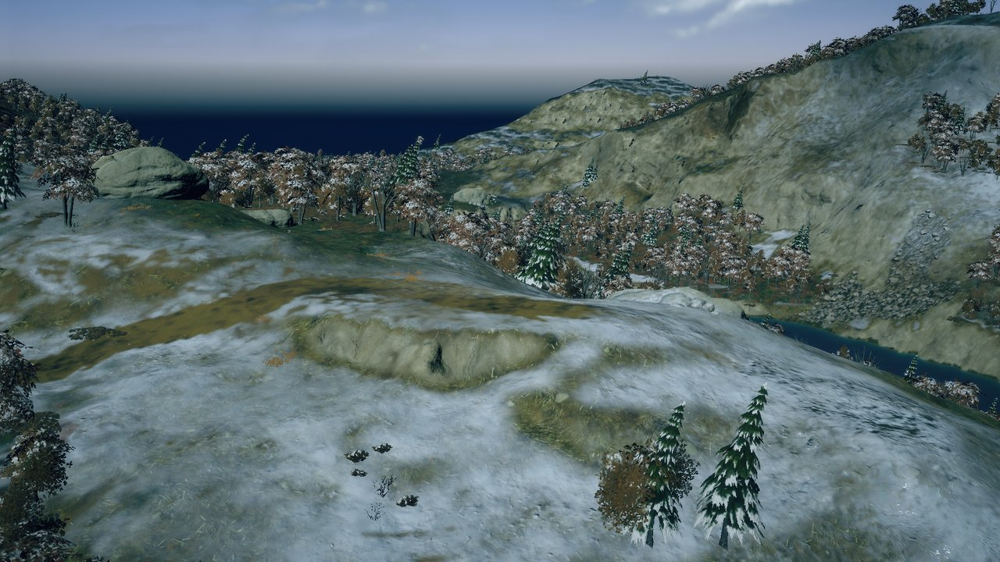
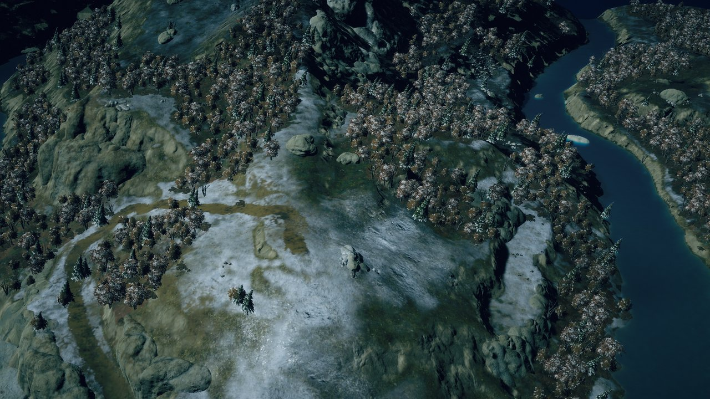
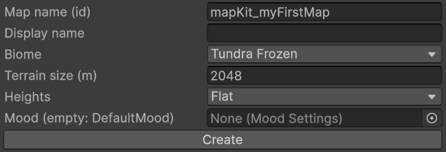
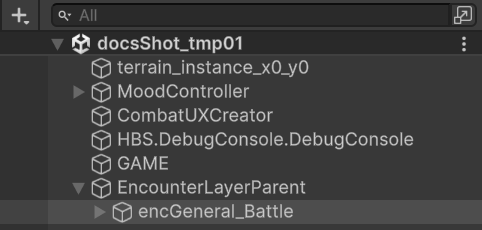
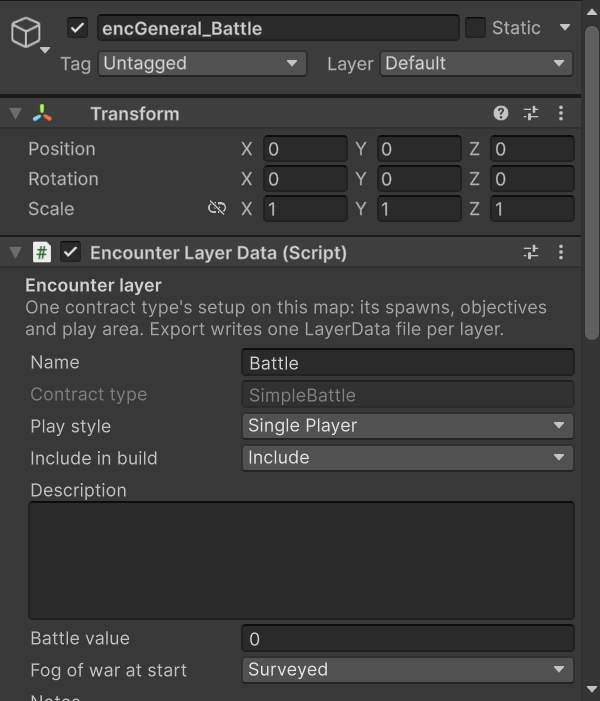
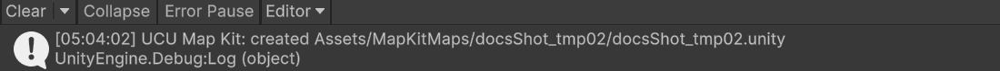
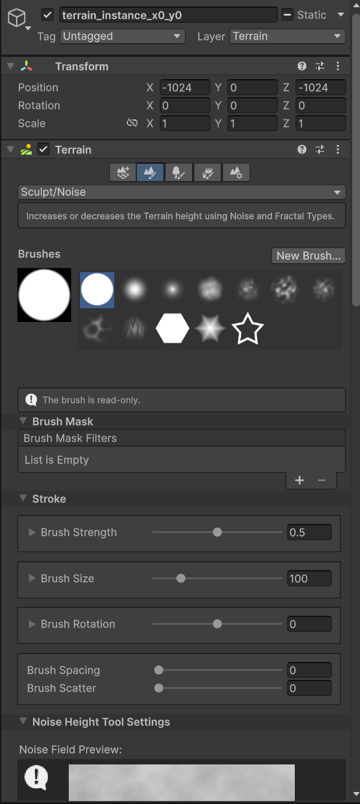
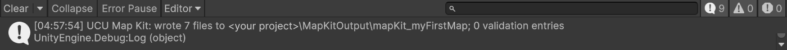

# Your first map, step by step

This guide takes you from nothing to a contract played on a map of your own in UCU. It assumes you have never used
Unity. Follow the steps in order. Each step ends with **You should see**, which tells you what the screen shows when the
step worked. If yours differs, stop and read [If something goes wrong](#if-something-goes-wrong).

There are two ways to get a map, and a part of this guide for each:

- **Guide A, [make a new map](#guide-a-make-a-new-map)**: start from the kit's template (flat ground, a sky, lighting and
  two lances already set up) and shape it.
- **Guide B, [clone a retail map](#guide-b-clone-a-retail-map)**: copy one of the game's own maps from your retail install
  and edit the copy. The shipped map stays as it is.

Both start with [Part 1](#part-1-set-up-once), which you do once, and both end with
[Part 2](#part-2-check-bake-build-and-play), which turns the map into a mod and plays it.

This guide only says what to do. To learn what terrain, encounter layers or the lighting bake are, read
[How it works](../README.md#how-it-works). The README also describes the tools this guide does not walk through (roads,
moods, ambushes, dialogue, extra contract layers): [The editing tools](../README.md#the-editing-tools).

Before you start, read the requirements in [README.md](../README.md#prerequisites). Where this guide says
`<UCU>`, it means the folder UCU is installed in (the one with `BattleTech.exe`). `<retail>` is the folder of your
retail BATTLETECH install (the one with `BattleTech_Data`). `<project>` is your Unity project folder, and `<kit folder>`
is the folder you keep the kit in.

## The Unity parts you will use

You only need these parts of the Unity Editor window. Each is explained where it is first used.

- **Hierarchy**: the list of every object in the open scene (step A1).
- **Inspector**: the settings of the object you selected (step A1).
- **Scene view**: the 3D view of your map, where you look around and move things (step A2).
- **Console**: messages from Unity and the kit. Red lines are errors (step 1.6).
- **Project** window: your files, by folder.

## Part 1: Set up once

Do these steps once. After that you can make as many maps as you like in the same project.

### Step 1.1: Check what you need

Go through the [prerequisites table](../README.md#prerequisites) and make sure each row is true on your computer. The ones
people miss:

- Unity Hub: install it, sign in and activate a licence first (Unity's own instructions: [Managing licenses](https://docs.unity.com/en-us/hub/manage-license)).
- Unity Editor **6000.6.9f1**, installed from Unity Hub. Any other version is refused.
- A UCU install with ModTek in it (next step).
- The .NET 10 SDK and the .NET 8 runtime, both. Mapkit Asset Manager (step 1.7) runs only on .NET 10, and `ilspycmd` only on
  .NET 8. A newer .NET alone does not replace either. Setup also needs the SDK, to build `MapKitLoader`.
- `ilspycmd` version 9.0.0.7889. Install it with `dotnet tool install -g ilspycmd --version 9.0.0.7889`. Setup refuses another
  version.
- `git`, once, to fetch AssetRipper's source when you build Mapkit Asset Manager (step 1.7). The kit was tested with git 2.54.0.
- Python 3. To extract retail maps (step 1.7) it also needs `pip install UnityPy==1.25.0 numpy imagecodecs OpenEXR Pillow`.

Where this guide shows a command, run it in a PowerShell window. Put every path in a command in double quotes, as the commands
below do: a path with a space in it, such as one under `Program Files (x86)`, fails without them.

The kit's tests ran on machines where Unity was already signed in and licensed.

**You should see:** each row of the table is true. If one is not, fix it now. Setup checks your UCU and retail folders, ModTek,
`dotnet`, Unity and the project before it writes anything. It does not check Python, which its first step needs, or `ilspycmd`,
which its fifth step needs.

### Step 1.2: Put ModTek in your UCU folder

Your map reaches the game as a mod, and ModTek is the program that loads mods. UCU's installer does not install it.

1. Download a **ModTek v4** release from [github.com/BattletechModders/ModTek/releases](https://github.com/BattletechModders/ModTek/releases).
   The kit was tested with 4.4.10.
2. Put the release's `ModTek` folder inside `<UCU>\Mods`.
3. Do not copy ModTek's own `winhttp.dll` or `doorstop_config.ini`. UCU's *Mod support* option already installed its own, and
   ModTek's `winhttp.dll` crashes UCU's Direct3D 12 start.

**You should see:** the file `<UCU>\Mods\ModTek\lib\0Harmony.dll` exists.

### Step 1.3: Create the Unity project

1. Choose a folder name for your mod, for example `mapKit_myMap`. The project's folder is named after your mod, and
   setup gives the project the same name (Unity Hub lists it under that name).
2. In PowerShell, run this, with your own folder at the end. Unity makes the project and quits:

   ```
   & "$env:ProgramFiles\Unity\Hub\Editor\6000.6.9f1\Editor\Unity.exe" -batchmode -quit -createProject "<some folder>\mapKit_myMap"
   ```

   If Unity Hub put the Editor somewhere else, use that path to `Unity.exe`.
3. If the prompt comes back at once, wait until `<some folder>\mapKit_myMap\Packages\manifest.json` exists before you go on.
   Setup refuses a folder without it.

**You should see:** a `mapKit_myMap` folder with `Assets`, `Packages` and `ProjectSettings` inside it, and
`Packages\manifest.json` in it.

### Step 1.4: Put the kit folder outside the project

Copy the kit folder to a place outside `<project>`, for example next to it. Download the kit from
<https://github.com/BATTLETECH-Unofficial-Community-Update/Map-Editor>.

**You should see:** `<kit folder>\setup\setup-project.ps1` exists.

### Step 1.5: Run setup

1. Close Unity. Setup refuses to run while Unity has the project open.
2. In PowerShell, run (all on one line):

   ```
   powershell -NoProfile -ExecutionPolicy Bypass -File "<kit folder>\setup\setup-project.ps1" -Ucu "<UCU>" -Retail "<retail>" -Project "<project>"
   ```

   Add `-Unity "<path to Unity.exe>"` if Unity 6000.6.9f1 is not in Unity Hub's default folder. Setup is a script you run
   before the kit is in the project, not a menu item in Unity.
3. Wait. Setup decompiles the game's code and compiles the project, so it takes a while.

**You should see:** nine lines beginning `== 1/9 packages` to `== 9/9 first compile`, and last
`SETUP OK: <project> (log …)`. Setup writes its logs to a folder named `mapkit-work` beside your project. If it stops
earlier, the last lines name what is wrong: see [If setup stops](#if-setup-stops). Setup runs once per project: running it
again on the same project is refused.

### Step 1.6: Open the project in Unity

1. Add the project folder to Unity Hub's project list and open it from there. Hub lists it under your folder's name.
2. Wait until Unity finishes loading. The first open took at most 16 minutes on the one machine where it was
   timed. The Editor window appears.
3. Open the **Console**: in Unity's top menu bar choose **Window → General → Console**. Press **Clear** in the Console's
   toolbar to empty it.

*Unity basics:* the **Console** shows Unity's and the kit's messages. A white line is information, a yellow line a
warning and a red line an error.

**You should see:** no red lines in the Console, and a **UCU Map Kit** menu in the top menu bar.

### Step 1.7: Bring in the game's art

A new map is built from the ground textures, mood and sky of one biome, and these come from your retail install. You copy
them into your project by extracting at least one retail map. **Taiga River** gives the `tundraFrozen` biome, the one the
kit is tested with.

The extraction uses a program called **Mapkit Asset Manager**. You build it once.

1. In PowerShell, run (it needs `git` and a .NET SDK that builds `net10.0` (step 1.1), and internet once, for the source and the
   NuGet packages):

   ```
   powershell -NoProfile -ExecutionPolicy Bypass -File "<kit folder>\assetripper-patches\build.ps1" -Src "<a work folder>" -Out "<a tool folder>"
   ```

2. In Unity, choose **UCU Map Kit → Setup → Extract Retail Maps…**. The **Extract Retail Maps** window opens.
3. **Retail BATTLETECH folder**: setup filled it in. If it is empty or wrong, press **Find my install** (it looks in the
   usual Steam and GOG folders) or **Browse…** to the folder that holds `BattleTech_Data`. Not the UCU folder.
4. **Mapkit Asset Manager**: press **Browse…** and choose the `AssetRipper.CLI.dll` in the tool folder you just built.
   These two fields are remembered for your Windows user, not for one project, so a new project opens with the ones the last
   kit project used: check both.
5. Press **List the retail maps**. Nothing is extracted yet. The list comes from the game's own data: each map's name, biome
   and size, and its DLC if it has one. Maps with a retail icon show it. For most of the others the kit ships a picture of the map, and the row says `preview: kit
   picture`. The few that have neither show a grey box marked **no preview yet**. A line under the list counts each kind.
6. Tick **Taiga River**. For Guide B, also tick Split River (its id is `mapArena_splitRiver_iTnd`), which you will need there.
   Each ticked map shows the disk it needs at the peak, and the window checks that the disk has room before it starts.
7. Press the button at the bottom, which reads **Extract 1 map** (it counts the maps you ticked). The maps are done one after the other, each in six steps:
   **Stage input**, **Export (Mapkit Asset Manager)**, **Embed scene logic**, **Cut the closure**, **Import** and **Delete the
   export**. The window shows the step it is on. If a step fails, the run stops and names the step and the reason. Keep Unity
   open while it runs. When the last map ends, Unity imports the new files.

   The size check compares the map's extracted assets with the same assets in the game, and stops a map whose total is more
   than twice the game's. The moods that come with the map (below) are checked the same way. One kind of asset alone may be over twice (meshes, texture arrays and the scene are, because Unity
   stores them as text where the game stores them packed); the log lists those for every map and they do not stop it.
8. Later you can come back to this window and tick more maps. A map added later fits beside the earlier ones.



**You should see:** each map you ticked marked **Extracted** in the list, and a line `Done: … in the project (Assets/Level
Design/Maps)` under the list. Each map's scene is at `Assets/Level Design/Maps/<map>/<map>.unity`. The moods the game
uses on that map's biome come with it, into `Assets/MapKitRetailMoods`, so **New Mood…** can copy them. The picture above is the
window before the run; in it the two folder fields show placeholders instead of real paths.

Now choose a guide:

- [Guide A: make a new map](#guide-a-make-a-new-map), then [Part 2](#part-2-check-bake-build-and-play).
- [Guide B: clone a retail map](#guide-b-clone-a-retail-map), then [Part 2](#part-2-check-bake-build-and-play).

## Look at a retail map first (optional)

The kit opens any map you extracted in the game's own camera and lighting, so you can see how a retail map looks. This
changes nothing in the map.

1. Open the map's scene: double-click it in the **Project** window (`Assets/Level Design/Maps/<map>/<map>.unity`). If you
   have changed anything, save first (**File → Save**): the preview refuses to open on a scene with unsaved changes.
2. Choose **UCU Map Kit → Preview → Open Game-View Preview**. The **Map Preview** window opens.
3. Pick a **Mood** (time of day and weather, from the moods the game allows on this map's terrain type) and click
   **Open**. The Game view (the Game tab beside the Scene tab) now shows the map from the camera's **Position**, **Euler**
   (the camera's angles) and **FOV** (its field of view). Change those numbers to move the camera; the view follows.
   Known problem: on some maps a *Foggy* mood shows an almost black view. Pick another mood (the screenshots below use
   *ArcticDayFrozen*).
4. **Save PNG…** writes the current view to an image file.
5. When you are done, click **Close** (or **UCU Map Kit → Preview → Close Preview**). The scene goes back to exactly what is
   saved on disk.



Once the preview is open, the button reads **Reopen**, and **Lighting path** shows which lighting route the preview uses.
The blue box lists what the preview leaves out, such as weather effects and the game's UI.

**You should see:** the map in the Game view, with its terrain, sky, haze and water, near and far.





The preview is a guide to your map's look. Check the final look in UCU itself: on some maps distant ground draws darker in
the preview than close ground, and whether the game does the same is still being checked.

## Guide A: Make a new map

### Step A1: New map from the template

1. In Unity's top menu bar, choose **UCU Map Kit → New Map from Template…**. A window titled **New Map from Template**
   opens.
2. Fill in the fields, top to bottom. (The screenshots in this guide come from test maps, so some names differ.)

   

   | Field | What to enter |
   |---|---|
   | **Map name (id)** | The map's internal name, for example `mapKit_myFirstMap`. It becomes the scene's file name and the map's id in the game, so use letters, numbers and underscores, and no spaces. It must not contain the word "template", and it must not match a scene already in the project. |
   | **Display name** | The name players see in the map list. Leave it empty and the kit makes one from the map name (`mapKit_myFirstMap` becomes "Map Kit My First Map"). |
   | **Biome** | The kind of land: it picks the ground textures. **Tundra Frozen** (`tundraFrozen`) is the one tested so far. It needs the art of a map with that biome in your project (step 1.7). |
   | **Terrain size (m)** | The width of the ground in metres. Leave it at `2048`, the size the kit is tested with. It must be a power of two of at least 256 (256, 512, 1024, 2048…). |
   | **Heights** | `Flat` for level ground, or `Noise` for random hills. With `Noise`, a **Noise amplitude (m)** field appears: how high the hills go. |
   | **Mood (empty: DefaultMood)** | Leave it empty to use the game's default time of day and weather. |

3. Press **Create**. The window closes, and the new map opens in Unity. The kit saves it as
   `Assets/MapKitMaps/<map name>/<map name>.unity`, next to its terrain and the other files it needs.

The new map has two encounter layers, which are the game's setups for one kind of contract each:

- `encGeneral_Battle`, a **SimpleBattle** layer: the career contract where two lances fight until one is destroyed. Your
  lance starts at the south and the enemy lance at the north, 300 m either side of the middle of a 2048 m map. The play
  area is 1200 m wide and 1000 m deep.
- `encArena_Skirmish`, an **ArenaSkirmish** layer: the one that puts the map in the game's Skirmish map list, and the one
  **Test map in UCU** plays. It has two player lances, `Player1LanceSpawner` at the north and `Player2LanceSpawner` at the
  south, 600 m either side of the middle on a 2048 m map, and a play area 1500 m square. You play Player 1.

*Unity basics:* the **Hierarchy** panel (on the left by default) lists every object in the open scene. Click one to
select it; its settings then appear in the **Inspector** panel (on the right). The **Console** shows the kit's messages.
If you can't see one of these panels, open it from the **Window → General** menu.



(The picture is from an older template with one layer; your map has two.)

Open `EncounterLayerParent` with its small arrow to find the two layers, then click `encGeneral_Battle`. The Inspector shows
the encounter layer's settings. **Contract type** reads `SimpleBattle`; it can't be edited here. The plain fields are under **HBS
fields** at the bottom.



**You should see:** a Console line `UCU Map Kit: created Assets/MapKitMaps/<map name>/<map name>.unity`, and no red
lines. An information line `AudioEvents [LOG] Applying mood [NO MOOD SELECTED]` may appear as well: the game logs it while it
sets up the lighting, and it is harmless.



The Hierarchy lists, among others, `terrain_instance_x0_y0` (the ground), `MoodController` (the lighting and weather) and
`EncounterLayerParent` (with the two layers). If Unity shows a red line instead, it says what is wrong: for example, a map
name with a space or with the word "template", a name already used, or a biome whose art is not in the project (go back to
step 1.7).

### Step A2: Look at the map

*Unity basics:* in the **Scene view** (the **Scene** tab in the middle), hold the right mouse button and use **W A S D** to fly
around, scroll to zoom, and press **F** to frame the selected object.

1. In the Hierarchy, click `terrain_instance_x0_y0`.
2. Move the mouse over the Scene view and press **F**. The view frames the ground.
3. Choose **UCU Map Kit → Mode → Encounter**. The kit's overlay, titled **UCU Map Kit**, opens in the Scene view. Its
   buttons are **Terrain**, **Terrain Types**, **Objects**, **Encounter** and **Check**. **Terrain** selects the map's terrain, so
   Unity's terrain inspector holds the brushes (step A3); **Check** opens Map Check (step 2.1).

**You should see:** the **Encounter** button in bold, with a **Layer** drop-down below it, and the lists **Lances (2)**,
**Play area (1)**, **Objectives** and **Regions (0)**, each with a count. In the Scene view, the layer shows its lances as
coloured circles (blue for the player, red for the enemy) and the play area as a yellow rectangle. Choose the mode's menu
entry again to leave the mode.

### Step A3: Shape the ground

The template's ground is a Unity *terrain*: a grid of heights. You raise, lower and roughen it with brushes. Setup added
Unity's **Terrain Tools** package (`com.unity.terrain-tools` 5.3.3) to your project, and it supplies the brushes used here.

*Unity basics:* a *brush* paints in the Scene view while you hold the left mouse button and drag over the ground.

1. In the Hierarchy, click `terrain_instance_x0_y0`. The Inspector shows its **Terrain** component, with a row of
   five buttons under its name.
2. Click the second button (the mountains with a brush). A drop-down under the row lists the brushes. Open it and pick
   one of these:
   - **Sculpt/Noise** raises and lowers the ground with a noise pattern: rolling hills and rough ground.
   - **Erosion/Hydraulic** wears the ground the way running water does.
   - **Stamp Terrain** presses the shape of the brush into the ground. It is the strongest of the three, so start with
     a low strength.
3. Pick a brush shape from the **Brushes** list, then set **Brush Strength** and **Brush Size** in the **Stroke** section.
   Size is in metres.



4. Drag over the ground in the Scene view. Each press-and-release is one stroke. Press **Ctrl+Z** to undo a stroke and
   **Ctrl+Y** to redo it.
5. To change the brush without going back to the Inspector, hold **S** and move the mouse sideways to change the size, or
   hold **A** and move the mouse sideways to change the strength. Let go of the key to keep the new value. (**D** does the
   same for rotation.)
6. Save with **Ctrl+S**. This saves the scene and the terrain's heights together.

**You should see:** the ground rise and fall under the brush as you drag, and the stroke disappear when you press Ctrl+Z.

What the brushes do to a new template map (measured with strength 1; heights are above the bottom of the terrain's height
range). A new map's ground starts flat at 190 m. That is about where retail's typical map has its ground: across retail's 78
terrain maps the middle of the ground is at 190 m, and the lowest part of a typical map is at about 88 m. A brush changes only
the ground under it: in every test nothing outside the brush's square moved.

- **Sculpt/Noise**, five overlapping dabs at size 200: raises the ground by up to 82 m (to 272 m).
- **Stamp Terrain**, one dab at size 200: raises it by up to 100 m (to 290 m).
- **Erosion/Hydraulic**, five dabs at size 300: digs up to 82 m on flat ground (down to 108 m). Twenty strong dabs on one
  spot got no lower than 95 m. On rolling ground (**Noise** heights) it is gentler: about 14 m for five dabs and about 50 m
  for twenty.

Erosion does not reach 0 m, the bottom of the range, in a few strokes. Undo and redo bring the ground back exactly.
Noise and Stamp give the same result every time you repeat a stroke, on the same map or on a new one. Erosion does not:
repeating the same erosion stroke changes about half of the same points by a different amount (on average half a metre,
at most about 5 m), so you cannot rebuild an eroded map by repeating its strokes.

### Step A4: Move the lances, the play area and the regions

In **Encounter mode** you place where each lance starts and how big the play area is. Which lance, and which play area, depends
on the layer: test play uses `encArena_Skirmish`.

1. Choose **UCU Map Kit → Mode → Encounter** (or press **Alt+Shift+4**). The **UCU Map Kit** overlay opens in the Scene view.
2. In the overlay's **Layer** drop-down, pick the layer you want to edit: `encArena_Skirmish` for the Skirmish test, or
   `encGeneral_Battle` for a career contract. This is the *active layer*: it is the one shown in the scene and edited here.
   Changing it is one Undo step.
3. The overlay lists what the layer holds, each with two buttons: the object's name, which selects it, and **Frame**, which
   selects it and moves the Scene view to it.
   - **Lances**: each lance and its four unit spawn points. `Player1LanceSpawner` and `Player2LanceSpawner` in the
     Skirmish layer; `Spawner_PlayerLance` and `Lance_Enemy_OpposingForce` in the battle layer.
   - **Play area**: the rectangle units may move in (`EncounterBoundaryRect`).
   - **Objectives**: what each side must do. The template's are *destroy the enemy lance*. Select one to read it in the
     Inspector: **Title**, **Description**, **Needed by contract** and so on.
   - **Regions**: areas that objectives and triggers use. A new template map has none, so this list reads **None in this
     layer.** A region arrives with a layer or an ambush you copy in from a retail map (see
     [The editing tools](../README.md#the-editing-tools)).
4. Press **Frame** next to `Player1LanceSpawner`. The Scene view moves to the lance.
5. Drag the small square handle at the lance's centre. The lance's four spawn points move with it. When you let go, the
   points snap to the hex grid and to the ground. Ctrl+Z undoes the move. Unity's own move arrows are hidden for these
   objects, because the kit's handle is the one that snaps.
6. With the lance selected, a ring appears around it: drag the ring to turn the lance. A small box beside the handles has number fields
   **X**, **Z** and **Facing**: type a number and press **Enter** to place the lance exactly.
7. To change the play area, press `EncounterBoundaryRect` (or **Frame**), then drag the cube handle on one of its sides, or
   type the **West**, **East**, **South** or **North** edge in the number fields. The opposite edge stays where it is.
8. The lance's Inspector also has a button, **Snap to hex and ground**, if you moved a spawn point by hand.
9. Save with **Ctrl+S**.

**You should see:** the lance and its four spawn points at the new place, standing on the ground, and the yellow play-area
rectangle around them. If a spawn point or a lance is outside the play area, or in the 50 m band along the map edge, Map
Check lists it (step 2.1).

### Step A5: Mark terrain types (optional)

A *terrain type* tells the game what a patch of ground is: water, forest, rough, road and so on. It decides where units can
go and how much cover they get. A new map has none marked. The mode shows them; the paint tool marks them.

1. Choose **UCU Map Kit → Mode → Terrain Types**. The overlay lists a legend: **Edge band**, **Impassable**, **Deep water**,
   **Water**, **Road**, **Custom**, **Forest**, **Rough**, each with a colour, a pattern and the number of cells. A *cell* is
   4 m square. In the Scene view, each cell is drawn with the colour and pattern of its type. The yellow line is the play
   area, the white line is the inner edge of the edge band (the outer 50 m, where units cannot go whatever is painted), and
   white hexes show the hex grid around the cursor, with the type of the cell under it.
2. Press **Paint Terrain Type** in the overlay (or press **Alt+Shift+T**, or choose **UCU Map Kit → Paint Terrain Type**). The
   terrain is selected and its Inspector shows the **Paint Terrain Type** tool, with a **Terrain type** grid of **Water**,
   **Deep water**, **Forest**, **Rough**, **Road**, **Impassable**, **Custom** and **Clear**.
3. Pick a type (or press **Shift+1** to **Shift+8**, in that order), pick a brush, and drag in the Scene view. Painting adds the type; where
   two types overlap, the game keeps one (the order of the legend). **Clear** removes every type under the brush.
4. Under **Derive from the map** are two helpers: **Forest from trees** (paints forest within **Within (m)** of at least
   **At least (trees)** trees) and **Water below height** (**Below height (m)**). Press **Preview** to see where one would
   paint, then **Apply**, or **Cancel**.
5. Save with **Ctrl+S**. The overlay says `N mask(s) painted since the last save: save the scene (Ctrl+S) to write them` until you do.

**You should see:** the painted cells in the type's colour, and the counts in the legend change. Ctrl+Z undoes each stroke.

### Step A6: Place objects (optional)

The **Objects** palette holds the game's rocks, buildings and other props. It is empty until you build the object library
once from a retail map you extracted. The step changes the scene it runs on, so run it on a copy of the extracted map, not
on the extracted scene itself.

1. Open the extracted map's scene (double-click `Assets/Level Design/Maps/mapGeneral_taigaRiver_iTnd/mapGeneral_taigaRiver_iTnd.unity`
   in the **Project** window), and save a copy of it as in [step B1](#step-b1-save-a-copy-under-your-own-id), under any id.
2. With the copy open, choose **UCU Map Kit → Setup → Build Object Library…**. A dialog titled **Build Object Library** describes
   what it will do and asks `Write the library and point the scene's renderers at it?`. Press **Build**. The library is written to
   `Assets/MapKitLibrary`. Save the copy (**File → Save**).
3. Open your own map's scene again. Choose **UCU Map Kit → Objects…**. The **Objects** palette opens.
4. Type in the search box to find an object, or press a kind button: **All**, **Rocks**, **Structures**, **Water**, **Decals** or
   **Lights**. Drag a tile into the Scene view, or select it and click in the Scene view. **Random rotation** and **Random
   scale** vary what you place.

**You should see:** the object standing in the scene, and `Page 1 of N (M objects)` under the tiles. If the palette says `No objects in
Assets/MapKitLibrary/Prefabs`, step 2 has not run on an extracted map yet.

### Step A7: Name the map (optional)

1. Choose **UCU Map Kit → Map Settings**. The **Map Kit** window opens on its **Map** tab.
2. Type **Display name**: the name players see in the map list. **Biome**, **How often it is picked** and **Map tags** are there
   too.
3. **Preview picture** is the picture in the Skirmish list. Leave it, and Build Mod draws one from above. Or press **Choose a
   file…** for a PNG of your own.

**You should see:** the new name in the **Display name** field.

Guide A continues in [Part 2](#part-2-check-bake-build-and-play).

## Guide B: Clone a retail map

Guide B copies one of the game's own maps, edits the copy, and builds it as a mod. The retail map in your project stays
as it is. Do Part 1 first, with **Taiga River** and **Split River** both extracted (step 1.7). The steps follow the order in
which they work: some of them refuse to run if an earlier one has not.

### Step B1: Save a copy under your own id

1. Open the extracted map's scene: double-click `Assets/Level Design/Maps/mapGeneral_taigaRiver_iTnd/mapGeneral_taigaRiver_iTnd.unity`
   in the **Project** window.
2. Choose **File → Save As**. Save it into a new folder `Assets/MapKitMaps/<your id>/`, with the file name `<your id>`.
   The id is letters, numbers and underscores, with no spaces, and without the word "template".
   Save any sculpting before you do: unsaved changes to the ground stay in the original.

The kit then copies the map's terrain next to the new scene (`<your id>_terrain.asset`) and saves the copy pointing at it, so
changing the copy leaves the original alone. It also writes `<your id>_layer-links.json` beside the scene, which records which
retail map the copy came from; the steps below read it. You will also see a `<your id>Settings.lighting` there. A freshly extracted map has no terrain-type masks yet, so there are no
`<your id>_mask_*.png` files at this point: step B6 makes them. The copy keeps the display name the original scene had until you
change it (step A7: **Map Settings**), so give it your own.

**You should see:** `<your id>_terrain.asset` and `<your id>_layer-links.json` beside the scene in the **Project** window. A
copy made another way (Unity's *Save As Copy*, or duplicated in the Project window) still shares the original's terrain: Map
Check lists each shared asset with a **Fix** button. If a map already has masks of its own (one that has been through step B6),
Save As copies its seven `<your id>_mask_*.png` files too.

### Step B2: Build the object library

Straight from the extraction, the map's rocks and buildings draw pieces of the game's combined (static-batched) meshes. These
can't be moved, and the lighting bake can't size them. This step gives each object a mesh of its own.

1. With your copy open, choose **UCU Map Kit → Setup → Build Object Library…**.
2. The dialog titled **Build Object Library** asks `Write the library and point the scene's renderers at it?`. Press **Build**.
3. Save the scene (**File → Save**).

**You should see:** a Console line giving the number of new meshes and prefabs written (0 new, with the number already there, if you
have built the library before). Step B5 refuses a copy that skipped this
step. If the dialog shows an error instead, it says what is wrong: for example, `Open a saved map scene first.`

### Step B3: Add an ArenaSkirmish layer

Skirmish lists only maps that have an **ArenaSkirmish** layer, and most retail maps have none (Taiga River has none). The
arena maps do, so you copy one from **Split River**.

1. Choose **UCU Map Kit → Add Contract Layer…**. A window titled **Add Contract Layer** opens.
2. The window opens on another contract type. **Contract type**: pick **ArenaSkirmish**. **Copy from**: pick the Split River
   entry.
3. Press **Add layer**.
4. Save the scene (**File → Save**).

The layer is copied into your map, moved to your map's play area and snapped to the hex grid and the ground. The **Map Kit**
window opens on **Map Check** and lists anything in the layer that pointed at the source map; those entries are warnings.

**You should see:** the window's last line `Added … (ArenaSkirmish) from … : N encounter objects, … source-map links cleared`.
Map Check shows one **Error** until step B6: `Terrain … has no SplatMapInfo, so the map has no terrain types.` That is
expected on a copy that has no masks yet, and step B6 clears it. If the **Contract type** entry says `(no extracted map has
one)`, extract Split River (step 1.7) and press **Rebuild index**. If **Add layer** refuses because the map already has a
layer of that name, the window says so and the Console shows one red line.

### Step B4: Check the lances (and edit, if you want)

The copied lances were placed inside your play area. Look at them, and move them if you want them elsewhere.

1. Follow [step A4](#step-a4-move-the-lances-the-play-area-and-the-regions), choosing the new `encArena_Skirmish` layer in the
   **Layer** drop-down.
2. Shape the ground ([step A3](#step-a3-shape-the-ground)) and place objects ([step A6](#step-a6-place-objects-optional), from
   its step 3: step B2 already built the library) if you want to.
3. Leave terrain-type painting until after step B6: step B6 rebuilds the masks.
4. Save with **Ctrl+S**.

**You should see:** the Skirmish lances inside the yellow play-area rectangle, on the ground.

### Step B5: Prepare the lighting from retail

A shipped map loses its lighting data when it is extracted. This step sets the copy up to bake the way retail's own map was
baked: it reads retail's lighting layout from your retail install and from the extraction, and gives baked lighting only to
the objects retail lit and to the terrain.

1. Choose **UCU Map Kit → Setup → Prepare Lighting from Retail**.
2. A dialog reports what it did and ends `Save the scene, then Bake Lighting.`. Press **OK**.
3. Save the scene (**File → Save**).

**You should see:** that dialog. If instead a dialog says the retail map is not found, or that the map `is not a map
extracted from retail, and it records no retail map it was saved from`, see [If a clone step refuses](#if-a-clone-step-refuses).

### Step B6: Rebuild the terrain-type masks

A shipped map also loses the masks that say where water, forest, rough ground and roads are. This step rebuilds them from the
map's own shipped data.

1. Choose **UCU Map Kit → Setup → Rebuild Terrain-Type Masks from Retail**.
2. Save the scene (**File → Save**).
3. Now you can paint your own changes: [step A5](#step-a5-mark-terrain-types-optional).

**You should see:** a Console line `UCU Map Kit: wrote 7 masks (…) from … Save the scene to keep the SplatMapInfo.`, and the
seven `<your id>_mask_*.png` files beside the scene. Map Check no longer shows the `SplatMapInfo` error.

### Step B7: Name the map

Follow [step A7](#step-a7-name-the-map-optional). The copy still carries the display name of the map it came from, so type
your own **Display name** on the **Map** tab.

Guide B continues in [Part 2](#part-2-check-bake-build-and-play).

## Part 2: Check, bake, build and play

You do these steps for either guide. The map must be the open scene, and saved.

### Step 2.1: Map Check

1. Press **Ctrl+S** to save the scene.
2. Choose **UCU Map Kit → Map Check**. The **Map Kit** window opens on its **Check** tab and runs the check. Press **Check map**
   to run it again.

Map Check lists the map's problems: the game's own validation of each layer, what the exporter needs, and the kit's
checks. It changes nothing in the scene.

Each entry shows **Error** or **Warning**, a sentence about the problem, and the object it is about. **Select** selects
and frames that object. Some entries have a **Fix** button, which repairs it as one Undo step; Map Check then runs again.
An **Error** stops Build Mod. A **Warning** is listed and does not stop it. A **Fix** changes the scene, so save afterwards.

**You should see:** a new template map: `<scene path>: no problems found (0 entries).` A clone shows no errors but some warnings.
On the Taiga River clone that was tested, after steps B1 to B6, Map Check listed 8 warnings: a play area reaching into the 50 m
edge band (3), spawn points in water (2), a link to the source map (`source-map-link`, 1), an ambush that
refers to nothing (1) and trees that stand outside forest (1). They describe the map as it was copied; see
[If Map Check lists something](#if-map-check-lists-something) before you act on them.

### Step 2.2: Export the map data (optional)

Build Mod does this step by itself. Run it alone only to see what the exporter writes.

1. Make sure your map is the open scene.
2. Choose **UCU Map Kit → Export Map Data**.

The kit runs the game's own map exporter, which checks each encounter layer the way the game does, then writes files to
`MapKitOutput/<map name>/` in your Unity project folder (next to `Assets`, not inside it): the ground as
`<map name>_TerrainData.bin`, and for each encounter layer three files named after it, for example
`<map name>_encGeneral_Battle_LayerData.bin`, `…_LayerData_RaycastInfo.bin` and `…_LayerData_InclineMesh.IMS`. A template
map has two layers, so that is 7 files. The Taiga River clone has six, plus a contract file, so that is 20.

**You should see:** a Console line `UCU Map Kit: wrote 7 files to …; 0 validation entries`. (In the screenshot below
the start of the folder path is replaced with `<your project>`.) A
number of validation entries above 0 means the game's check rejected an encounter layer, and the Console lists what it found
wrong. Fix those and export again.



### Step 2.3: Bake the lighting

A *bake* is the step where Unity works out how light bounces around your map and saves it to files. The kit's own button does
it with settings sized to the game's own maps.

1. Make sure the scene is saved.
2. Choose **UCU Map Kit → Bake Lighting and Test Map**. The **Map Kit** window opens on its **Build** tab.
3. Under **Lighting**, read **Estimate** (the size of the bake, against retail's) and **Lighting data**: `Needs a bake: the map
   has no lighting data of its own`.
4. Press **Bake lighting**. The window shows `Running: Baking <map name>: …` while it works. The bake saves the scene once when it
   ends.

The kit does not start a bake whose estimate is more than twice retail's size, and it measures the result afterwards and reports
it in red if it is more than twice.

**You should see:** under the button `Done: Baked and saved: N systems, … B of terrain GI (… x retail's …)`, and **Lighting
data** reads `Up to date`. A clone that skipped step B5 is refused (see
[If a clone step refuses](#if-a-clone-step-refuses)).

Build Mod does not bake. If you copy the mod by hand (step 2.5), bake first. **Test map in UCU** (next step) bakes for you
when the lighting data is missing or older than the terrain.

### Step 2.4: Build Mod and test the map

1. Make sure the scene is saved. Build Mod refuses a scene with unsaved changes.
2. Choose **UCU Map Kit → Build Mod…**. The kit works through six steps, and names each in the Console as it finishes:
   **1/6 Map id**, **2/6 Check and export**, **3/6 Icon**, **4/6 Bundle**, **5/6 mapkit-map.json**, **6/6 mod.json**. The first
   Build Mod in a new project is long: 53 minutes for a template map with no dropship (one run on one
   machine). It compiles the game's shaders for the bundle and keeps them in the project's `Library` folder, and the Editor
   is busy until it ends. Later builds reuse them: the second build of a Taiga River clone took 131 seconds; a template map's
   second build was not timed. The first Build Mod of a map that holds a dropship, Taiga River among them, is long too (54
   minutes on the tested machine, even in a project that had built before). Don't close the Editor while it works. **Test map
   in UCU** runs the same build.
3. Open the folder `<project>\MapKitOutput\<map name>`. This is your mod.

**You should see:** a Console line `UCU Map Kit: Build Mod wrote 14 files to <project>\MapKitOutput\<map name>. Copy that folder into
<UCU>/Mods/.` for a template map with no moods or contracts of its own (27 files for the Taiga River clone). The folder holds `mod.json`, `mapkit-map.json`,
`bundle/` (the map's asset bundle and Unity's two small manifest files) and `data/` (the map data and the Skirmish icon).
If a step fails, the Console's red line `UCU Map Kit: Build Mod stopped at step …` names the step and what is wrong.

**Test map in UCU** does the next steps for you:

1. In the **Map Kit** window's **Build** tab, under **UCU install**, type or **Browse…** to your `<UCU>` folder in
   **UCU install folder**. The line below it reads `BattleTech.exe found.`
2. Press **Test map in UCU** (or choose **UCU Map Kit → Test Map in UCU**). It checks the map, exports it, bakes if the
   lighting is out of date, builds the mod, copies it into `<UCU>\Mods\<map name>`, installs the **MapKitLoader** mod if it is
   missing or older than the kit's copy, and starts UCU with `-ucuMap <map name>`. Each step shows in the window as `Done: …` and in the Console as
   `UCU Map Kit: Test map step 1/8 …` to `8/8`.
3. UCU starts and plays the way in by itself: it skips the intro, opens Skirmish, picks your map, starts the mission, and
   presses BEGIN MISSION. You click nothing. The lances are the lobby's own, a random lance for each side, and the mood is
   the one the lobby picks.
4. In the game, check the first turn: your lance stands on its spawn points, an objective reads **Destroy Enemy Lance**, and
   you can move and attack. Then leave through the pause menu.

**You should see:** your map's first turn. If UCU opens at the main menu or the lobby instead, read
[If the map does not start](#if-the-map-does-not-start).

### Step 2.5: Install the mod by hand (instead of Test map)

Use this to put the map into another UCU install, or when you want to start UCU yourself.

1. **Install `MapKitLoader` once**, in `<UCU>\Mods\MapKitLoader\`. Every kit map needs it, and one copy serves all of them.
   Setup built it into `<project>\MapKitOutput\_loader\MapKitLoader` (that folder holds `MapKitLoader.dll`, its `.pdb` and `mod.json`):
   copy that folder into `<UCU>\Mods`. For another UCU install, build it again from the kit's `Loader~` folder with the
   .NET SDK, using the command in the [README](../README.md#test-in-ucu).
2. Copy `<project>\MapKitOutput\<map name>` into `<UCU>\Mods`.
3. Start UCU, press **Skirmish**, and pick your map. Or start it from a command line with the map's id and let
   `MapKitLoader` do those clicks: `BattleTech.exe -ucuMap <map name>`. Add `-ucuContract "<layer id, name or guid>"` to pick
   one of the map's Skirmish layers; with no match, or without it, the first Skirmish layer is used.

**You should see:** `<UCU>\Mods\<map name>\mod.json` and `<UCU>\Mods\MapKitLoader\MapKitLoader.dll`, and your map in the
Skirmish map list under its display name. When you start UCU yourself without `-ucuMap`, the game's first-launch notices show
as they normally would.

## If something goes wrong

Start with the Console in Unity: a red line says what is wrong, and most of what follows is what that line means.

### If setup stops

Setup checks a list of things before it writes anything: your UCU and retail folders, ModTek, `dotnet`, the project, the kit
folder and Unity. Later steps can still stop it: Python at step 1 and `ilspycmd` at step 5. Its last line names the problem.

| Setup says | What to do |
|---|---|
| `Not a UCU install: …Assembly-CSharp.dll is missing.` | `-Ucu` must be the UCU folder, the one with `BattleTech_Data`. |
| `… has no Mods\ModTek` | Install ModTek v4 into `<UCU>\Mods\ModTek` (step 1.2). UCU's installer does not do it. |
| `The .NET SDK (dotnet) is not on PATH` | Install the .NET 10 SDK (step 1.1) and open a new PowerShell window. |
| `Not a BATTLETECH install: …` | `-Retail` must be your retail folder, the one with `BattleTech_Data`. Not the UCU folder. |
| `Not a Unity project: …Packages\manifest.json is missing.` | Create the project first (step 1.3). |
| `The project is not a Unity 6000.6.9f1 project` | Create it again with Unity 6000.6.9f1. |
| `Setup runs once, on a new project: … already has the kit or the game code.` | Make a new project (step 1.3). To move a project to a newer kit, see [Updating the kit in a project](../README.md#updating-the-kit-in-a-project). |
| `Run setup from a kit folder outside the project` | Move the kit folder out of `<project>` (step 1.4). |
| `Unity 6000.6.9f1 is not at …` | Pass `-Unity "<path to Unity.exe>"`. |
| `Unity has … open. Close it and run setup again.` | Close Unity (step 1.5). |
| an error from PowerShell naming `py` or `python`, at step 1 | Install Python 3 (step 1.1). |
| `ilspycmd is not installed: …` or `ilspycmd 9.0.0.7889 is needed (found: …)` (step 5) | Run the `dotnet tool` command it prints, then see the next paragraph. |
| `ilspycmd did not start (exit …) …` (step 5) | Install the .NET 8 runtime (step 1.1): this `ilspycmd` runs on no other version. Then see the next paragraph. |
| `SETUP FAILED at the first compile` | The first compile had errors. Open the log it names, in `mapkit-work\logs`. |

Setup stops at the first step that fails. Its logs are in `mapkit-work\logs`, beside your project. Once step 5 has copied the
game code into the project (or step 6 has copied the kit), setup refuses to run on that project again, so a failure after that
point needs a new project (step 1.3). The `ilspycmd` check at step 5 comes before that copy, so a rerun after installing the
right `ilspycmd`, or the .NET 8 runtime, is allowed.

### If the template will not create

- `Map name [x] must be a file name without spaces`, or `must not contain "template"`: choose another **Map name (id)**. The game
  skips any file whose name contains "template", so the map would not load.
- `A scene named [x] already exists in this project.`: choose another name.
- `No Biome asset for [tundraFrozen] in this project: set up the art of a map with this biome first.`: extract a map with that
  biome (step 1.7).
- `Terrain size [x] must be a power of two of at least 256 m.`: type 256, 512, 1024 or 2048.

### If Map Check lists something

| Map Check says | What to do |
|---|---|
| `… is outside the play area` | Move the spawn point inside the yellow rectangle in Encounter mode (step A4). |
| `… is in water` or `on impassable ground or deep water` | Move the point to open ground, or paint the ground there as another type. |
| `… has N spawn points on M different hexes. A lance needs four points, each on its own hex` | Move the points apart. **Snap to hex and ground** in the lance's Inspector helps. |
| `… is in the 50 m map edge band` | Move it at least 50 m in from the map edge. |
| `Play area … reaches into the 50 m map edge band` | Make the play area smaller or move it inward. |
| `The map has no display name` | Type a **Display name** on the **Map** tab (step A7). |
| `Map id "…" is already used by …` | Rename one of the scenes. |
| `N of M trees … stand outside forest` | On a map you made, press **Fix** (it paints forest under every tree) or remove the trees. On a clone, retail's own trees can be listed: **Fix** would repaint retail's forest, so leave the warning unless you want that. |
| `… is marked as an obstruction … but has no renderer` | Give the object a mesh, or remove its obstruction component. |
| `CameraStart … is not at local zero under …` | Press **Fix**. |
| `source-map-link` warnings on a clone | Expected: they list links in a copied layer that pointed at the source map. They do not stop Build Mod. |
| the other warnings on a clone (play area in the edge band, spawn points in water, an ambush that refers to nothing) | They were listed on the tested clone, which had an arena layer added but was otherwise not edited. A spawn point on impassable ground or deep water is an Error: move it. Warnings do not stop Build Mod. Move or change things only if you want to; the rows above say how. |
| `Terrain … has no SplatMapInfo, so the map has no terrain types` on a clone | Expected until step B6, which makes the masks. An Error: Build Mod stops until then. |
| a shared-asset entry with **Fix** | Press **Fix** to give the copy its own terrain or masks, then save. |

After a **Fix**, the Check tab says the scene has unsaved changes. Save it before Build Mod.

### If a clone step refuses

- `… is not a map extracted from retail, and it records no retail map it was saved from.`: the copy has no record of its
  source. A copy saved with an older kit has none. Save a new copy from the retail map (step B1).
- Prepare Lighting refuses and names **Build Object Library**: run step B2 first, save, and prepare again.
- `No retail LightingData for …: extract the map again`: a map extracted before this step existed has to be extracted
  again (step 1.7), because the extraction now keeps the retail lighting file.
- The bake says `Not started: … whose lighting has not been prepared`: run step B5, save, and bake again.
- The bake says `Not started: the estimate is …, more than 2x retail`, or `Baked and saved, but the lighting is …: more than 2x
  retail`: the map's lighting inputs differ from retail's. The message says to stop and find what differs before using the map.
  The bake's sizing was calibrated on Taiga River only, so another map may bake larger.
- **Add Contract Layer** finds no ArenaSkirmish source: extract Split River (step 1.7) and press **Rebuild index**.
- `The open map already has a layer named …`: Export names a layer's files after the layer, so two of one name would overwrite
  each other. Delete the map's own layer of that name in the Hierarchy, then add the copy.
- Map Check's `Two encounter layers are named …`: the same problem in a map that already has both. Rename or delete one of them
  in the Hierarchy. Names that differ only in capitals, or in a space against an underscore, count as the same.

### If the bake, Build Mod or Test map stops

- `Save the map scene first.` or `The scene has unsaved changes.`: save with **Ctrl+S** and run it again. Map Check does not
  change the scene, but a **Fix** does.
- `Close the other open scenes first.`: the bake works on one scene.
- `A bake is already running.`: wait for it to end.
- `Map Check found N error(s)`: fix them in the **Check** tab (step 2.1), save, and build again.
- `Map id [x] contains a space` or `contains "template"`: rename the scene file.
- `No UCU install folder is set`, or `… has no BattleTech.exe`: set **UCU install folder** to the folder UCU is installed in.
- `… has no Mods\ModTek`: install ModTek v4 (step 1.2).
- `… is not installed and the .NET SDK (dotnet) is not on this machine`: Test map builds `MapKitLoader` with it. Install the
  .NET SDK, or build and install the loader by hand (step 2.5).
- Test map stops at **4/8 Bake lighting**: read the bake line above it. A failed bake stops the chain.

### If the map does not start

Open `MapKitLoader.log` in `<UCU>\Mods\MapKitLoader`. It has one line per map and per layer it registered, and one line when
a step does not happen. If the map's id is not in the Skirmish map list, the loader leaves the game where it is, at the main menu
or the lobby. If a map's `mapkit-map.json` is broken, the log says so, and the other maps still load.

- The map is not in the Skirmish list: the map folder is not at `<UCU>\Mods\<map name>\mod.json`, or `MapKitLoader` is not in
  `<UCU>\Mods`, or the map has no ArenaSkirmish layer. The template and a clone with step B3 done both have one.
- The game opens but does nothing by itself: you started it without `-ucuMap`. Pick the map in Skirmish, or start it with the
  argument (step 2.5).

### Other things seen

- **The first Build Mod keeps the Editor busy for a long time.** This is the shader compile. Later builds reuse it,
  except the first one of a map that holds a dropship, Taiga River among them, which is long too (step 2.4 has the times).
- **The Extract Retail Maps fields point at another project's tool.** They are remembered per Windows user, not per project.
  Check **Mapkit Asset Manager** and **Retail BATTLETECH folder** before you press **Extract**.
- **A road you baked does not show in the game.** A template map's ground is the biome's dirt-road texture, which is what shows
  a road. Paint the ground with another texture first (the terrain inspector's *Paint Texture* tool), then bake the road.
- **An ambush never springs.** Only a unit with the tag `player_unit` springs it. Every retail player spawner carries it, and
  so does the template's SimpleBattle spawner. Map Check gives an error for an ambush that no player spawner's units can
  spring. A map made before the template set it needs the tag added in the spawner's **Encounter tags**. Ambushes are
  described in [The editing tools](../README.md#the-editing-tools).
- **A mood bundle is missing.** `MapKitLoader` logs one line starting `MOOD_BUNDLE` and the game picks one of its own moods.
- **Preview shows an almost black view.** Pick another **Mood** in the **Map Preview** window.
