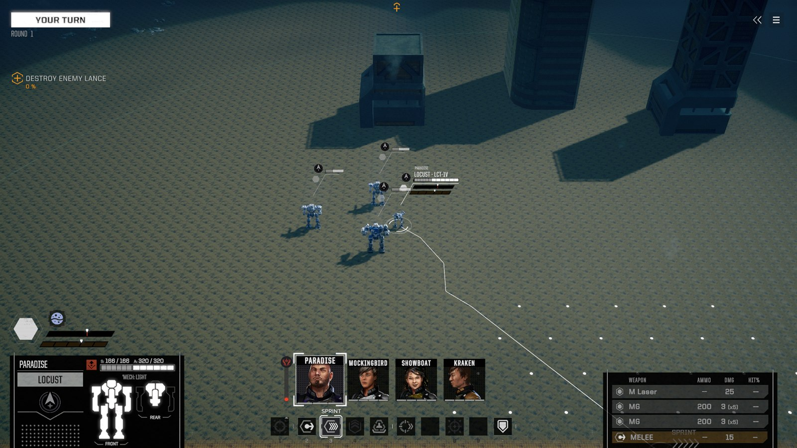
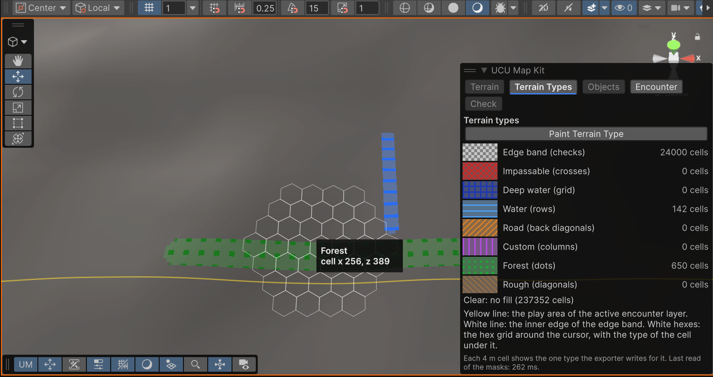

# UCU Map Kit

> **Status: Beta: in development. Requires UCU to use and to play modded maps.**

The UCU Map Kit lets you make a new map for BATTLETECH and play a contract on it. It is a set of tools that runs inside
the Unity Editor (the program BATTLETECH was built with). You build the map in Unity, select a couple of buttons on the menu, and the kit
writes a mod folder. Copy that folder into your game and the new map shows up in the game.

You do not need to be a 3D artist. A new map starts from a template with flat ground, a sky and lighting already set
up. You shape the ground, place the art the game already has, and mark where the lances start and
where the objectives are. Alternatively, you can clone an existing map and edit it.



*A new map made from the template, with three buildings placed on it, played in UCU.*



*Painting terrain types (forest and water) on a new map, in the Unity Editor.*

## Why the kit needs UCU, and why there is no kit for retail BATTLETECH

Maps made with the kit require [**BATTLETECH: Unofficial Community Update (UCU)**](https://btucu.org), a free community update of the game.  

Retail BATTLETECH was never released with a way to build maps. Harebrained Schemes (HBS) built the game's maps in
the Unity Editor with their own level-design tools, but they never released those tools.

To move BATTLETECH to a current Unity version, UCU had to reconstruct parts of the game, recover the game's shaders, and get the game's art to load correctly. That rebuilt project is the foundation for MapKit:

- setup turns your UCU install's game code into source inside your own Unity project, so some of HBS's own level-design code
  runs in your Editor: the map exporter, the encounter layers that hold spawns and objectives, and the mood system that
  lights a map;
- your map's art and lighting are built with the same Unity version UCU runs on;
- your map reaches the game as a mod: the kit installs its own small loader mod, MapKitLoader, which ModTek (the
  community mod loader, which you add to your UCU install; see [Prerequisites](#prerequisites)) runs, and which registers
  your map with the game.

A kit for retail would need a second rebuild of the whole game in retail's version of Unity (2018.4). We rely on Unity's
general rule that content built with a newer Unity version does not load in an older one. That means reconstructing
and maintaining the entire game a second time on that older version. See [this (admittedly old) post](https://www.reddit.com/r/Battletechgame/comments/fbgs1c/player_created_maps/) from the BT community member who has done (by far) the most
work on maps, CWolf -- he's exactly right about the lift required, and we don't have the resources to make this project work for the retail release, or to support it if we did.

Map-kit uses your retail install: it copies the game's art from it into your Unity project, on your machine.
A map you build carries the art it uses in its bundles ([NOTICE](NOTICE.md)). The kit carries no game code, meshes, textures or maps. Pictures that show game content are in it: 68 overhead map
preview pictures in `previews/`, and five screenshots in `Documentation~/images/`. It also carries UCU's recovered shaders
(see [Rights and licensing](#rights-and-licensing)). [NOTICE](NOTICE.md) lists all of them.

## A Community Effort: Your Help Required

The UCU team that publishes MapKit does not have experience in 3D level design or environmental art. Unlike UCU itself, where we have a strong sense of how it should work and ways to measure whether or not we're achieving that goal, we're not consumers of applications like MapKit; so we need you to tell us what's working and what could be better. MapKit accepts public contributions, so please feel free to clone it and submit a pull request!

## Documentation

| Read this | When |
|---|---|
| [Your first map, step by step](Documentation~/walkthrough.md) | You are new to the kit or to Unity. It walks you from an empty project to a contract played on your own map, in two guides: make a new map, or clone a retail map. |
| [Map Atlas](Documentation~/atlas.html) | You want to pick a retail map to clone or study. It lists every map the game ships, filterable by biome, kind, content pack and contract type, with each map's playable area and the contracts it supports. Download it and open it in a browser. |
| This README | Prerequisites, setup, the menu items and the editing tools, building the mod and testing it in UCU. |
| [DEVELOPING.md](DEVELOPING.md) | You work on the kit itself. |

What has been tried: agents followed this README in a new project on a second machine, with nothing but this kit, Unity, a
UCU install and a retail install. They drove the steps with scripts, not by clicking: some scripts call the same menu actions,
and some call the kit's functions directly, which skips the window (for example, the clone route's Add Contract Layer step
was run that way). That first run needed three workarounds: ModTek had to be copied in by hand, Add Ambush left its lance outside the play area, and
the retail-clone route ([Edit a retail map](#edit-a-retail-map)) failed at its step 3. Those were fixed, and the clone route
was run again from Save As in the same project, through Build Mod and a played Skirmish. It was then run once more from a fresh
extraction through Build Mod, using the menus and windows wherever an agent can; some dialogs and buttons were still skipped. A person has tried only part
of the windows and buttons. Nobody has followed these documents by hand from start to finish yet, and no one has accepted the result.

## What a kit-built map can and cannot do

- **It loads in UCU, not in retail BATTLETECH** (see [Why the kit needs UCU](#why-the-kit-needs-ucu-and-why-there-is-no-kit-for-retail-battletech)).
- It is a new map. The kit does not change the maps that ship with the game.
- It uses the game's own art (terrain textures, buildings, trees, rocks, skies), taken from your own copy of the game.
- The kit can open the game's own maps, DLC maps included, from your retail install, to study, preview or edit
  ([Extract a retail map](#extract-a-retail-map)). The shipped map stays as it is.
- The template has two encounter layers: a *SimpleBattle* layer, for the career contract type where two lances fight
  until one is destroyed, and an *ArenaSkirmish* layer, which is what puts the map in the game's Skirmish map list.
  **Add Contract Layer…** copies other contract types' layers from the retail maps you have extracted.
- A map's name must not contain the word "template". The game skips every file whose name contains it, so the map would
  not load. The kit refuses such a name.
- In the Editor, the game's materials do not look exactly as they do in the game: water, trees, the sky and the ground
  colour differ, because part of the game's lighting is only set up while the game runs. Check the look of your map in
  UCU.
- Co-op play on a kit map: not tested.

## Prerequisites

| You need | Notes |
|---|---|
| **Windows** | Only Windows has been tried. |
| **Unity Hub and Unity Editor 6000.6.9f1** | The exact version UCU is built with. Free from [unity.com](https://unity.com/download). No extra install module: Build Mod builds the map for Windows 64-bit (`BuildTarget.StandaloneWindows64`), and the Windows Editor carries that build support itself. |
| **A UCU install, with mod support on and ModTek in it** | Setup reads the game code from it, and you test your map in it. Your map arrives as a mod, so the install needs two things. (1) The installer's *Mod support* box, on by default: it puts Doorstop and UCU's bootstrap beside the game, which let a mod loader start; it does not install ModTek. (2) **ModTek v4**, the mod loader itself: download a release from [github.com/BattletechModders/ModTek/releases](https://github.com/BattletechModders/ModTek/releases) (the kit was tested with 4.4.10) and put its `ModTek` folder in your UCU folder's `Mods`, so that `<UCU>\Mods\ModTek\lib\0Harmony.dll` exists. Leave out ModTek's own Doorstop files (its `winhttp.dll` and `doorstop_config.ini`): *Mod support* already installed UCU's, and ModTek's `winhttp.dll` crashes UCU's Direct3D 12 start. Setup and **Test Map in UCU** refuse a UCU folder without `Mods\ModTek` and say what is missing. A UCU install takes about 40 GB. Lowest UCU version the kit supports: 2.3.1-4B. |
| **Your retail BATTLETECH install** (Steam or GOG) | The kit copies art from it into your project, on your machine. Tested with GOG and with a Steam install on a second drive. |
| **.NET 10 SDK, .NET 8 runtime and `ilspycmd` 9.0.0.7889** | Install both .NET versions: `ilspycmd` runs only on .NET 8, Mapkit Asset Manager only on .NET 10, and a newer version alone does not replace either. `dotnet tool install -g ilspycmd --version 9.0.0.7889`. Setup uses `ilspycmd` to turn UCU's game code into source the Editor compiles, and refuses another version. Setup and Test Map in UCU also use the SDK to build `MapKitLoader`, and Mapkit Asset Manager is built for `net10.0` (`assetripper-patches/README.md`). Tested with SDK 11.0.100. |
| **git** | Only to build Mapkit Asset Manager: the build fetches AssetRipper's source with it (`assetripper-patches/README.md`). Tested with git 2.54.0. |
| **Python 3** | Tested with 3.12 and 3.13. Setup does not check for it, and its first step needs it. Setup's own steps need only Python; extracting retail maps also needs `pip install UnityPy==1.25.0 numpy imagecodecs OpenEXR Pillow`. |
| **ffmpeg** with libvpx and libvorbis | Only for urban maps, whose billboard screens carry video. A full build (`winget install Gyan.FFmpeg`, or gyan.dev) with `ffmpeg` and `ffprobe` on PATH before you start the Editor. The kit converts retail's H.264 clips to VP8 `.webm`, as UCU does, because H.264 plays as colour bars under Proton. Without ffmpeg the conversion refuses and changes nothing. |
| **Mapkit Asset Manager** | Only to extract retail maps. It is AssetRipper 1.3.14 with the kit's patches (`assetripper-patches/`), built once by you. See [Extract a retail map](#extract-a-retail-map). |
| **Disk space** | About 23 GB for a project holding one map's art. Extracting a map needs up to 2.75 times its input files at its peak (Taiga River 19.6 GB, Terrace Plaza 23.6 GB), and each map adds about 1 to 3 GB to the project. Not measured for a project that holds only template maps. |

You do not need the UCU source code, its `tools/` folder, or any UCU developer setup.

## Setup

1. Install Unity Hub, sign in and activate a licence first (Unity's own instructions: [Managing licenses](https://docs.unity.com/en-us/hub/manage-license)), then
   install Unity Editor 6000.6.9f1 from the Hub.
2. Create a new, empty project with Unity 6000.6.9f1 from the command line (Unity makes the project and quits). Name the
   project folder after your map mod, for example `<some folder>\mapKit_myMap`, not `Project`:

   ```
   & "$env:ProgramFiles\Unity\Hub\Editor\6000.6.9f1\Editor\Unity.exe" -batchmode -quit -createProject "<your project folder>"
   ```

   That is the PowerShell form, with Unity Hub's default install folder; use yours if the Editor is elsewhere. The kit was tested with a project
   made this way; a project made from a Hub template has not been tried. If the prompt comes back at once, wait until
   `<your project folder>\Packages\manifest.json` exists. Put every path in a command in double quotes: a path with a space
   in it, such as one under `Program Files (x86)`, fails without them. The kit's tests ran on machines where Unity
   was already signed in and licensed.
3. Put the kit folder somewhere outside the project (download it from
   <https://github.com/BATTLETECH-Unofficial-Community-Update/Map-Editor>).
4. Run setup, with Unity closed:

   ```
   powershell -NoProfile -ExecutionPolicy Bypass -File "<kit folder>\setup\setup-project.ps1" -Ucu "<UCU install>" -Retail "<retail BATTLETECH install>" -Project "<your project>"
   ```

   Setup names the project after its folder: Unity Hub lists it under that name, and it is the project's product name.
   Add `-Name "<name>"` to choose another name, and `-Company "<name>"` for the company name (default `UCU Map Kit`).
   Add `-Unity "<path to Unity.exe>"` if Unity 6000.6.9f1 is not in Unity Hub's default folder. Setup writes its logs and
   the decompiler's output to `mapkit-work` beside your project (`-Work "<folder>"` to choose another). It runs two batch
   Unity sessions and takes a while; it ends with `SETUP OK`, or names the step that failed and stops there.
5. Open the project in Unity. The first open took at most 16 minutes on the one machine where it was timed. The Console
   should show no red lines. The project starts on Direct3D 12 (setup puts it first in the graphics API list, then Direct3D 11).
6. Bring in the art of at least one map with the biome you want ([Extract a retail map](#extract-a-retail-map)):
   **New Map from Template** builds its terrain from that biome's textures, mood and sky. Taiga River gives `tundraFrozen`.

The kit's Editor scripts have no assembly definition (asmdef), because an asmdef cannot reference the game code in
`Assembly-CSharp`. They compile with your project's other Editor scripts, so they work only after setup has put the game
code in the project. That is also why setup is a script you run before the kit is in the project, not a menu item.

### What setup does to your project

Setup makes these changes, in this order. They are listed so you can tell what changed if something goes wrong; you
don't do any of them by hand. Nothing is written to your UCU or retail install.

1. **Packages.** It adds `com.unity.ugui` 2.6.0, `com.unity.addressables` 3.1.0, `com.unity.mathematics` 1.4.0,
   `com.unity.nuget.newtonsoft-json` 3.2.2 (the game code's JSON library), `com.unity.terrain-tools` 5.3.3 and
   `com.unity.splines` 2.9.2 (`setup/add_packages.py`). Terrain Tools gives the terrain inspector its noise, erosion and
   stamp brushes; Splines is what **Roads…** draws a road with. Unity's packages keep their own licences (Splines: the
   Unity Companion License); the Package Manager installs them and the kit includes none of their files.
2. **Layers and tags.** It copies UCU's layer and tag table (`setup/ProjectSettings~/TagManager.asset`) into
   `ProjectSettings`: the game's prefabs and the template use the game's own layers.
3. **Compiler options.** It writes `Assets/csc.rsp` with `-langversion:12.0` and `-warnaserror-:0619`.
4. **Project settings** (`setup/MapKitSetup.cs`, run once in batch mode and then removed from `Assets`): linear colour
   space, .NET Framework API level, unsafe code allowed, deferred rendering, and the Windows graphics APIs Direct3D 12 then
   Direct3D 11. It also stores your retail folder for **Extract Retail Maps…**, and sets the project's name and company
   (`productName`, `companyName`, and `ProjectSettings/ProjectName.txt`, which is the name Unity Hub shows).
5. **Game code** (`setup/decompile.ps1`, `setup/fix-artefacts.py`, `setup/block-ns.py`). It decompiles
   `Assembly-CSharp.dll` into `Assets/HBS-Decompiled` and `Assembly-CSharp-firstpass.dll` into
   `Assets/Plugins/HBS-Decompiled-firstpass`. It moves the folder `BattleTech.Framework/` to `BattleTech/Framework/`
   (Unity skips any folder whose name ends in `.Framework`) and corrects eight lines the decompiler gets wrong, found by
   their content, not their line numbers. It rewrites each file's `namespace X;` line into the older `namespace X { … }`
   form: without that, Unity attaches none of the game's components to the objects in a scene, even though it reports no
   missing scripts. It copies the third-party DLLs the game code needs from your UCU install's `BattleTech_Data/Managed`
   (Harmony, DOTween, Steamworks.NET, protobuf-net, Mono.Data.Sqlite and others; not `Newtonsoft.Json.dll`, which would
   clash with the Newtonsoft package), UCU's native `sqlite3.dll` into `Assets/Plugins/x86_64`, and UCU's game database
   (`MetadataDatabase.db`) into `Assets/StreamingAssets/MDD`: the game's own map checks read contract types from it.
6. **The kit** is copied into `Packages/com.ucu.mapkit`.
7. **Deferred shaders** (`setup/deferred-overrides.py`). In `ProjectSettings/GraphicsSettings.asset` it points the deferred
   shading, deferred reflections and screen-space shadows shaders at the kit's copies of the game's own
   (`Shaders/Resources/hbs-shaders`), the same three overrides UCU's own project carries.
8. **`MapKitLoader`**, the loader mod every kit map needs ([Test in UCU](#test-in-ucu)). It builds the kit's `Loader~`
   source with the .NET SDK against your UCU install into `MapKitOutput/_loader/MapKitLoader` in your project.
9. **First compile**, with Unity's API updater on, because Addressables 3.1.0 uses two functions this Unity version has
   renamed. Setup checks that Unity exits cleanly with no compile error.

**Extract Retail Maps…** adds more the first time it runs: the game's Wwise sound engine (`AkSoundEngine.dll` and its four
`Ak*.dll` effect plugins) from your retail install into `Assets/Plugins/x86_64`, because the retail maps' sound objects
call it in the Editor.

### Updating the kit in a project

Setup runs once per project. To move a project to a newer kit folder, close Unity, delete
`<your project>\Packages\com.ucu.mapkit`, and copy the new kit folder there in its place (leave out any `__pycache__`,
`obj` or `.git` folder, as setup does). Open the project; the Console should show no red lines. Your maps, extracted maps
and `MapKitOutput` are not touched.

## Your first map

The [walkthrough](Documentation~/walkthrough.md) has the steps with screenshots.

1. **UCU Map Kit → New Map from Template…** Enter a map id (letters, numbers, underscores; no spaces; not "template"), an
   optional display name, a biome (`tundraFrozen` is the one tested), a terrain size (a power of two; 2048 tested), flat
   or noise heights, and a mood (empty: `DefaultMood`). **Create** makes the scene under `Assets/MapKitMaps/<map id>/`
   and opens it: terrain, sky, sun, the game's map objects, and the two encounter layers with both lances' spawns.
2. **Shape the ground** with the terrain brushes, Terrain Tools' noise, erosion and stamp brushes included.
3. Mark the terrain types, place objects, move the spawns and objectives: [The editing tools](#the-editing-tools).
4. **UCU Map Kit → Map Check** lists what is wrong. Any error stops the build; a new template map shows 0 entries.
5. Bake the lighting: **UCU Map Kit → Bake Lighting and Test Map** opens the Map Kit window's *Build* tab, and its **Bake
   lighting** button bakes ([Build Mod](#build-mod) does not bake). **Test map in UCU** bakes for you when the lighting data is
   missing or older than the terrain.
6. **UCU Map Kit → Build Mod…** ([Build Mod](#build-mod)), then [test it in UCU](#test-in-ucu). The first Build Mod in a new
   project is long: 53 minutes for a template map with no dropship (one run on one machine). It compiles
   the game's shaders for the bundle and keeps them in the project's `Library` folder, and the Editor is busy until it ends.
   Later builds reuse them: the second build of a Taiga River clone took 131 seconds; a template map's second build was not
   timed. The first Build Mod of a map that holds a dropship, Taiga River among them, is long too (54 minutes on the tested
   machine, even in a project that had built before). **Test map in UCU** runs the same build.

## Extract a retail map

The kit can bring maps from your retail install into your project, DLC maps included, to study, preview or edit, and to
supply the art (biomes, terrain textures, moods, objects) your own maps use.

1. Build Mapkit Asset Manager once:
   `powershell -NoProfile -ExecutionPolicy Bypass -File "<kit folder>\assetripper-patches\build.ps1" -Src "<a work folder>" -Out "<a tool folder>"`
   (needs `git`, and internet once for the source and the NuGet packages). The kit itself makes no network call and does
   not build it for you. AssetRipper is GPL-3.0; the kit runs it as a separate program and never links it.
2. **UCU Map Kit → Setup → Extract Retail Maps…**: check the retail BATTLETECH folder (setup filled it in; **Find my
   install** or **Browse** to change it), choose `<tool folder>\AssetRipper.CLI.dll`, press **List the retail maps**, tick
   the maps you want (each shows its peak disk need), press **Extract**. The maps are done one at a time; each scene
   lands in `Assets/Level Design/Maps/<map>/<map>.unity`, and the working files are deleted after each map. The window
   remembers the retail folder and the tool for your Windows user, not for one project: a new project opens with the
   ones the last kit project used, so check both fields before you press Extract. Tested on Taiga River, Terrace Plaza,
   Raw Cliffsides and Split River.
   On an urban map the Import step also converts the billboard video clips to VP8 `.webm` (needs ffmpeg, see
   Prerequisites). Each clip keeps its GUID, so every scene reference stays. A project extracted before this
   conversion holds `.m4v` clips. Close the Editor and run, once:
   `py -3 "<project>\Packages\com.ucu.mapkit\setup\to_webm.py" "<project>\Assets\VideoClip"`
   Add `--idle` to run ffmpeg at Idle priority. A second run changes nothing. If the project's clips are still
   `.asset` files (extracted before the kit staged their media, so the clips point at a media file the project lacks),
   run `py -3 -I "<project>\Packages\com.ucu.mapkit\setup\repair_videoclips.py" "<project>\Assets" "<retail BATTLETECH>\BattleTech_Data" "<report.tsv>"`
   instead, with the Editor closed: it puts back each clip's media under the clip's own GUID, repoints the urban scenes
   at it, converts it, and writes what it did to the report. It leaves no `__pycache__` in the kit.
   Tested on the three urban maps; an urban billboard plays its video in UCU.
3. **UCU Map Kit → Preview → Open Game-View Preview** shows the open map through the game's camera and lighting. On some
   maps a Foggy mood shows an almost black view, and distant ground may draw darker than in the game.
4. To make a map of your own from a retail map, see [Edit a retail map](#edit-a-retail-map). **Add Contract Layer…**
   and the Objects palette also take what they need from the maps you extracted.

## Edit a retail map

You can turn an extracted retail map into a new map of your own: change its ground, its encounters and its objects,
then build it as a mod like any kit map. The retail map in your project stays as it is.

1. Open the extracted map and save a copy under your own map id with **File → Save As**, into
   `Assets/MapKitMaps/<map id>/`. The kit then copies the map's TerrainData next to the new scene (`<map id>_terrain.asset`)
   and, if the map has terrain-type masks, its seven masks too (`<map id>_mask_*.png`), and saves the copy pointing at
   them, so sculpting and painting the copy leave the original alone. A freshly extracted map has no masks yet: step 4
   makes them, and until then Map Check shows an Error, `Terrain … has no SplatMapInfo`, which step 4 clears. A map saved before this existed (or with Unity's *Save As Copy*, or
   duplicated in the Project window) still shares them: Map Check lists each shared asset with a **Fix** button. Only
   assets still named for the map they came from are recognised; save before Save As, because unsaved sculpting stays
   in the original. The copy also records which retail map it came from (`copiedFrom` in `<map id>_layer-links.json`
   beside it); steps 3 and 4 read it. A copy saved with an older kit has no such record, and steps 3 and 4 refuse it:
   save a new copy from the retail map. Nothing in Save As changes the copy's display name, so it keeps the one the scene
   already had: type your own in the Map Kit window's *Map* tab (**UCU Map Kit → Map Settings**). Map Check warns only when
   the name is empty or the same as the map id.

   Then, with the copy open, run **UCU Map Kit → Setup → Build Object Library…** and save the copy. Straight from the
   extraction, the map's rocks and buildings draw pieces of the game's combined (static-batched) meshes, which can't be
   moved and which the lighting bake can't size; this gives each object a mesh of its own (and fills the Objects palette).
   Step 3 refuses a copy that skipped it.
2. Edit the copy with [the editing tools](#the-editing-tools). To list it in **Skirmish** it needs an *ArenaSkirmish*
   layer; most retail maps have none (Taiga River has none), so extract a retail arena map that has one, such as Split
   River (`mapArena_splitRiver_iTnd`, the same tundra biome as Taiga River), and add its layer with **Add Contract Layer…**
   (**Contract type** *ArenaSkirmish*, **Copy from** Split River, **Add layer**). The kit moves the copied layer to your
   map's play area and keeps its lances inside the terrain's edge band, so they are already placed; look at them in
   Encounter mode (pick the new layer in its **Layer** drop-down) and drag them where you want them. Leave terrain-type
   painting until after step 4, which rewrites the masks.
3. **UCU Map Kit → Setup → Prepare Lighting from Retail.** A shipped map loses its lighting data when it is extracted,
   so the kit sets the copy up to bake the way retail's own map was baked: it reads retail's lighting layout from your
   retail install and from the extraction, gives baked lighting only to the objects retail lit and to the terrain, and
   sizes each part to retail's. A map extracted before this step existed has to be extracted again, because the step
   needs the retail lighting file the extraction now keeps.
4. **UCU Map Kit → Setup → Rebuild Terrain-Type Masks from Retail.** A shipped map also loses the masks that say where
   water, forest, rough ground and roads are; this rebuilds them from the map's own shipped data. Then paint your own
   changes with **Paint Terrain Type**.
5. **UCU Map Kit → Bake Lighting and Test Map** opens the Map Kit window's *Build* tab; its **Bake lighting** button bakes
   the lighting. The bake stops if its size is more than twice retail's ([Build Mod](#build-mod)). If step 3 was skipped,
   the size check refuses to start and names **Prepare Lighting from Retail**.
6. **Map Check**, then **Build Mod…**, then [test it in UCU](#test-in-ucu). On the Taiga River copy that was tested, Map
   Check listed no errors and 8 warnings after steps 1 to 4: a play area reaching into the 50 m edge band (3), spawn points in
   water (2), a link to the source map (1), an ambush that refers to nothing (1) and trees outside
   forest (1). Warnings do not stop Build Mod. The trees entry's **Fix** paints forest under every tree, which on a copy
   repaints retail's forest: leave it unless you want that.

State of proof, on Taiga River:
- The rebuilt masks give back retail's terrain types exactly: an unedited copy exported the same flags in all 262,144 of
  the map's cells.
- A copy taken through steps 1 to 6 by agents (scripts that called the kit's functions directly, not its windows), in the
  project the first README run made on a second machine, was prepared on all 228 retail-lit objects (estimate 1.03 times retail) and baked to 20 lighting systems, 1.76 times retail's size (15.0 MB
  against 8.5 MB). It built a mod of about 605 MB, was listed in Skirmish with Split River's arena layer, and was played
  in UCU from the drop through moves and an attack back to the main menu. An ambush added with **Add Ambush** spawned
  its 4 units when the lance entered its region in a career contract.
- A second copy, from a fresh extraction, went through steps 1 to 6 with the menus and windows (the **Add layer** button
  included), except Save As, typing the display name, the Build Object Library and Prepare Lighting dialogs and the **Extract** and
  **Bake lighting** buttons, whose code was called directly. It baked to 20 lighting systems, 1.76 times retail's size, gave
  the same 8 warnings, and built a mod of the same size (605 MB). That copy was not played.
- An earlier edited copy (a 25 m mound, a spawn moved 87 m) was played from the first turn to withdraw, with the lance
  at the moved spawn. No one has judged the in-game lighting yet, and no other retail map has been tried.

Limits:
- The bake's sizing was calibrated on Taiga River only. Another map may bake larger, and the 2x stop then refuses it.
- Unity 6 gives an object's lower detail levels no baked lighting of their own; the light probes light them instead.
  Some full-detail objects are also left out of the bake, cause not known.
- A copy built without **Prepare Lighting from Retail** and a bake has sun, shadows and reflections, but none of the
  game's bounced light.

## The editing tools

All of them are on the **UCU Map Kit** menu, in the **Map Kit** window, and on the Scene view's Map Kit overlay. Its
buttons **Terrain**, **Terrain Types**, **Objects**, **Encounter** and **Check** are also **UCU Map Kit → Mode → …**, with
**Alt+Shift+1** to **Alt+Shift+5**; pressing the one that is on leaves it. **Terrain** selects the map's terrain, so Unity's
terrain inspector shows the brushes, and **Check** opens Map Check (also **UCU Map Kit → Map Check**). Every change is one Undo step.
The shortcuts can be changed in **Edit → Shortcuts…** under `UCU Map Kit`.

| Tool | What it does |
|---|---|
| **Map Check** (**UCU Map Kit → Map Check**) | Lists the map's problems: the game's own layer validation, what the exporter needs, and the kit's checks. Each entry names the object, with **Select**. Map Check changes nothing in the scene; an entry's **Fix** does, and the Check tab then says the scene has unsaved changes: save it before Build Mod. |
| **Inspectors** | The spawns, lances, boundary, regions, objectives and layers show plain labels; the game's field name is in each tooltip, and the original fields are under *HBS fields*. |
| **Encounter mode** | Lists the active layer's lances, boundary, objectives and regions. Drag a lance and its four spawn points follow; points snap to the hex grid and the ground on release; handles for facing, the boundary edges and region radius, with number fields beside them. |
| **Terrain Types mode** | Shows what the exporter will write for each 4 m cell: water, deep water, forest, rough, road, impassable, custom, each in a colour and a hatch of its own, plus the 50 m edge band, the play area and the hex grid near the cursor. |
| **Paint Terrain Type** | **Alt+Shift+T**, or the terrain inspector's paint tools: paints those types with Unity's brushes. **Shift+1** to **Shift+8** choose Water, Deep water, Forest, Rough, Road, Impassable, Custom, Clear. |
| **Terrain Tools** | Unity's noise, erosion and stamp brushes, added by setup. Erosion strokes do not repeat exactly; noise and stamp do. |
| **Map Settings** | The Map Kit window's *Map* tab: display name, biome, weight and map tags (kept on the scene's own game objects), and the preview picture, a PNG beside the scene that Build Mod uses as the Skirmish icon. |
| **Objects…** | A palette of the game's objects from **Setup → Build Object Library…** (run it once after extracting maps): rocks, structures, water, decals, lights, with search. Drag into the Scene view or click to place; random rotation and scale are options. Placed buildings count as buildings in the game. |
| **Add Contract Layer…** | Copies another contract type's encounter layer from an extracted retail map into your map, recentred on your play area and snapped to your ground; Map Check lists anything that pointed at the source map. It refuses a layer whose name the map already has, because Export names a layer's files after it: the template already has `encGeneral_Battle` and `encArena_Skirmish`, so delete the template's own layer before you copy one of that name. The refusal also writes one red Console line. |
| **Plot variants** | On an urban map, a plot's inspector has a *Variant* dropdown; the export follows the active variant. On a layer with no plot override (every layer **Add Contract Layer…** copies in) the dropdown adds one, keeping the other plots as they are, so the choice survives Map Check and Export. One Undo step. |
| **Roads…** | Add a road, shape it with Unity's spline tool, then **Bake**: a textured road mesh on the ground, the biome's dirt-road terrain texture painted under it (as on retail maps, this texture is what shows the road; the mesh blends into it), and the Road terrain type, as one Undo step. A new template map's ground is that same dirt texture (terrain layer 0, the biome's dirt-road layer), so first paint the ground with another layer using the terrain inspector's *Paint Texture* tool (on `tundraFrozen`, layer 2, `grassA`), or the road will not show. Like retail's roads, it also counts as a building in the game's line-of-sight data. Map Check warns about a road narrower than 4 m or one that leaves the map. Played in UCU: the road shows in combat, and its cells are Road cells with the road's move costs. |
| **New Mood…** | Copies a mood from the source list next to your map as a new mood under your own name, and tags it for a biome so every map of that biome can use it. Tune its fog, light and sky in its inspector. Build Mod packs the map's moods into a second bundle, `<map id>_moods`, and lists them in `mapkit-moods.json`; `MapKitLoader` adds them to the game's mood list at start and loads them from that bundle. Retail moods are untouched. The source list is the moods in the project: the retail moods that came with the maps you extracted, grouped by whether they belong to this map's biome, then `DefaultMood` and any other mood asset in the project. A mood you made with New Mood is not offered as a source. Extracting a map brings the retail moods the game uses on that map's biome (into `Assets/MapKitRetailMoods`). A copy of a mood with weather packs that weather's effects and textures into your mod's moods bundle (adding one took a tested bundle from 0.7 MB to 3.7 MB). A map you extracted before the kit brought moods has none: they come with the next map of that biome you extract. If the moods bundle is missing, `MapKitLoader` logs one line and the game picks one of its own moods. Played in UCU: the map shows its new mood. |
| **Add Ambush** | Copies one of the game's ambushes (a trigger region, a lance and its bonus objective) into the active layer, with new ids, where you point. It needs an extracted retail map with a *DestroyBase* layer, the only retail layers with a working ambush: Taiga River has one. The lance and its spawn points keep the source's distance from the trigger region where your play area holds them; where it does not, they are drawn in toward the region so each stays a hex inside the play area, and if that would put two points on one hex it refuses and asks you to point nearer the middle. If the copied trigger region would hold the player lance's spawn, it is shrunk so the spawn stays a hex outside it; closer than 48 m to the spawn it refuses. One Undo step. Map Check warns about an ambush that refers to nothing and about a trigger region that holds the player lance's spawn (the ambush would spring at the drop), and gives an error when no player lance spawner gives its units the tag the ambush needs (`player_unit`, which every retail player spawner carries; a map made before the kit set it on the template needs it added in the spawner's Encounter tags). See Contracts under [Build Mod](#build-mod). |
| **Add Dialogue** | Fills the mission start, success or failure dialogue with your lines, or adds a dialogue played when the selected objective succeeds or fails. |
| **Bake lighting** and **Test map in UCU** | The Map Kit window's *Build* tab (**UCU Map Kit → Bake Lighting and Test Map** opens it): [Build Mod](#build-mod) and [Test in UCU](#test-in-ucu). |

## Build Mod

Open your map's scene, save it, and choose **UCU Map Kit → Build Mod…**. The kit then works through six steps and
names each one in the Console as it finishes. If a step fails, it stops there and the Console's red line names the
step and what is wrong.

1. **Map id.** The map's id is the scene's file name. The kit refuses a scene with unsaved changes, an id with a
   space in it, and an id containing the word "template" (the game never loads those). Rename the scene file to fix
   either.
2. **Check and export.** The kit runs Map Check. Any error stops the build; warnings are listed in the Console and do not
   stop it. Then the kit writes the map data (**UCU Map Kit → Export Map Data** does only this step).
3. **Icon.** A picture of the map seen from straight above, 542 by 305 pixels, the size of the game's own Skirmish map
   pictures.
4. **Bundle.** The scene packed into an asset bundle for Windows.
5. **`mapkit-map.json`.** The map's entry for the game's map list: its id, its name, its biome, its tags and each
   encounter layer with its contract type.
6. **`mod.json`.** The file that tells UCU's mod loader what the folder holds.

Nothing in your scene changes. The result is one folder, `MapKitOutput/<map id>/`, in your Unity project's folder
(next to `Assets`, not inside it). The kit replaces that folder on every build.

| In the folder | What it is |
|---|---|
| `mod.json` | The mod's name (your map id), that it needs `MapKitLoader`, and the list of files below. |
| `mapkit-map.json` | The map's entry for the game's map list. |
| `bundle/` | The asset bundle (named after your map id in lower case) and Unity's two small manifest files. |
| `data/` | The map data from the export, and the icon. When the map has an ambush or dialogue, also a contract file, `<map id>_<contract type>_<contract>.json` (below). |
| `mapkit-moods.json` | Only when the map has moods of its own: their names and tags, and where their bundle is in `bundle/`. |

**Contracts.** When a layer has an ambush or dialogue, Export writes a contract file for it with the game's own
serializer. It starts from the retail contract of that type that fits the layer best, and adds the ambush, its lance
and the dialogue lines. Build Mod lists the file in `mod.json` as a `ContractOverride`. The contract requires the map's
own tag, which Build Mod adds to the map, so the game offers it only on your map: the game's own check passed it on its
map and refused it on all 56 retail maps of its type. A map with neither gets no contract file. Played in UCU:
the mission-start dialogue plays, entering the trigger region spawns the ambush lance
once, and the drop does not set it off.

**Build Mod does not bake.** Baking is a separate step: **UCU Map Kit → Bake Lighting and Test Map** opens the Map Kit
window's *Build* tab, and its **Bake lighting** button bakes the map's lighting with settings sized to the game's own maps.
Do it before Build Mod if you copy the mod by hand; **Test map in UCU** bakes for you when the lighting data is missing or
older than the terrain. The kit estimates the bake's size first and does not start a bake more than twice retail's; it
measures again afterwards and says so in red if the result is more than twice. For an extracted retail map, or a copy
saved from one, that has not been through **Prepare Lighting from Retail**, the size check refuses to start the bake
and names that step: its estimate would count only the terrain.

## Test in UCU

**Test Map in UCU** does it all: set your UCU install folder in the Map Kit window's *Build* tab, then press it. It builds
the mod, copies it and `MapKitLoader` into that install's `Mods` folder (a `MapKitLoader` of an older version is built again), and starts UCU
with `-ucuMap <your map id>`: the game skips its intro, opens Skirmish, picks your map and starts the mission by itself, BEGIN MISSION
included, with no clicks. The lances are the lobby's own (a random lance each side) and the
mood is the one the lobby picks. A game started this way skips the
first-launch notices (the Paradox welcome and the GDPR notice) for that session: `MapKitLoader` sees the
`UCU_MAPKIT_TESTMAP` variable Test map sets and leaves them out. Nothing is written to your settings, your analytics
setting is never changed, and the kit sends nothing anywhere. When you start UCU yourself, the notices show as they
normally would.

By hand:

1. **Install `MapKitLoader` once**, in `<UCU>/Mods/MapKitLoader/`. Every kit map needs it, and one copy serves all of
   them. At game start it adds every installed kit map to the game's map database and writes one line per map and per
   layer to `MapKitLoader.log` in its own folder; if one map's `mapkit-map.json` is broken, the log says so, and the other
   maps still load. The kit ships its source (`Loader~`), not a built copy. Setup built it into your project's
   `MapKitOutput/_loader/MapKitLoader` folder (`MapKitLoader.dll`, its `.pdb` and `mod.json`): that folder is the mod, so copy it.
   Test Map in UCU builds and copies it for you. For another UCU install, build it again from `Loader~` with the .NET SDK:

   ```
   dotnet build -c Release "-p:ManagedDir=<UCU>\BattleTech_Data\Managed" "-p:HarmonyDll=<UCU>\Mods\ModTek\lib\0Harmony.dll" -o "<somewhere outside the kit>\MapKitLoader"
   ```
2. Copy `MapKitOutput/<map id>/` into `<UCU>/Mods/`, so you have `<UCU>/Mods/<map id>/mod.json`.
3. Start UCU, open **Skirmish**, pick the map. Or start it with the map's id as an argument and let `MapKitLoader` do
   those clicks: `BattleTech.exe -ucuMap <map id>` (`-ucuMap=<map id>` works too). Add `-ucuContract "<layer id, name or
   guid>"` to pick one of the map's Skirmish layers; with no match, or without it, the first Skirmish layer is used, as in
   the lobby. `MapKitLoader` skips the intro, presses Skirmish and Single Player, selects the map in the lobby's own list,
   waits until both lances are filled, presses Play, and presses BEGIN MISSION when it is enabled. Without `-ucuMap`
   nothing of this is active. If the id is not in Skirmish's map list, or a step does not happen in time, one line goes to
   `MapKitLoader.log` and the game stays where it is (the main menu, or the lobby).

What has been shown: agents played a kit map in UCU from the first turn through move, attack, withdraw and the
after-action screen. A map made by following this README in a new project on a second machine was listed in Skirmish and
played from the drop through moves, an attack and withdraw, in UCU with and without Steam. That first run needed
workarounds, which were fixed afterwards (see [Documentation](#documentation)). Nobody has followed these
documents by hand from start to finish yet, and no one has accepted the result.

## How it works

You don't need this section to use the kit, but it explains what the menu items do.

- **The scene.** In Unity a level is a *scene*: a file that holds everything in the map. A kit map is one scene. The
  kit's code generates a fresh template scene for you, so no game map is copied: ground, sky, sun and the game's map
  settings.
- **Terrain.** The ground is a Unity *terrain*: a height map you raise, lower and smooth with brushes, painted with
  ground textures (grass, rock, sand). The game reads it, with the terrain-type masks, to decide where mechs can walk and
  how much cover each tile gives.
- **Encounter layers.** The game does not keep missions in a separate file. Each map carries *encounter layers* inside
  its scene, one per contract type: where each lance spawns, the objectives, and the regions that trigger events. They are
  objects in the scene with the game's own components.
- **Moods and the lighting bake.** A *mood* is the time of day and weather: sun angle, sky, fog. The game's lighting
  uses a *bake*, a step where Unity works out how light bounces around your map and saves it to files.
- **Export.** The game's own exporter reads the scene and writes the map data the game needs in combat: the terrain
  grid and each encounter layer.
- **The mod.** Build Mod packs the scene into an *asset bundle* (a file the game can load) and writes a mod folder: the
  bundle, the map data files, the entries that tell the game where to find them, and the map's entry for the game's map
  list. One shared mod, `MapKitLoader`, reads that entry from every kit map you have installed and adds each map to the
  game's map database.

### Shaders

The kit's `Shaders/` folder holds UCU's recovered BATTLETECH shaders, so the game's materials draw in your Editor. That
includes `BattleTech Mech Standard`, the dropship shader (the Leopard and Union dropship materials), and
`BattleTech/VFX/Additive` (particle effects in four of the game's scenes, such as Terrace Plaza's steam). A project whose
maps were extracted before the kit carried those two keeps those materials on Unity's pink error shader; extracting again
does not replace them, because the project already holds the materials.

The first Build Mod of a map that holds a dropship compiles the dropship shader's variants: 54 minutes on the machine we
tested, with a clone of Taiga River. The next build of that map took 131 seconds. (A new project's first
Build Mod is long without a dropship too: [Your first map](#your-first-map).) The two shaders were checked
on their materials in the Editor (no pink); not in a scene, in a played map, or against the game's own look. No map holding the
steam effect has been built.

## Known limits

- Maps load in UCU only, not in retail. Windows only so far.
- Bundle textures are larger than retail's (one measured bundle: 392.7 MiB of textures against about 76 MB in retail).
- Contract types other than SimpleBattle and ArenaSkirmish come only from retail layers (**Add Contract Layer…**).
- Baking a road again after moving it does not give the old band its old terrain texture back (Undo does).
- Lowest supported UCU version: 2.3.1-4B, the only one the current `MapKitLoader` was played on.
- Cloning a map you made with the kit (rather than one of the game's) is not documented or tried.
- **New Mood…** can start only from a mood already in the project: extract a map of a biome to get that biome's retail moods.
  Copying one was tried on a tundra map only.

## Rights and licensing

The code and documents in this repository were written for UCU and are licensed under the MIT License; see
[LICENSE](LICENSE). That license does not cover BATTLETECH game code, art, shaders, data or trademarks, or the
screenshots of game art in the documentation: [NOTICE](NOTICE.md) lists those, and the third-party tools setup runs
with their own licences.

- **Mapkit Asset Manager**, the patched AssetRipper: **GPL-3.0**. The patches in `assetripper-patches/` are GPL-3.0
  changes to a GPL-3.0 program; the kit runs it as a separate program and never links it.
- Upstream tools keep their own licences: ilspycmd (MIT), AssetRipper (GPL-3.0), UnityPy (MIT), and the third-party
  libraries setup copies from your UCU install (Harmony, DOTween, Steamworks.NET, protobuf-net, Mono.Data.Sqlite).

The kit contains no game code, meshes, textures or maps. Setup reads the game's code and art from your own UCU and retail
installs into a project on your machine. A map you build carries the art it uses in its bundles. What the kit does ship that shows or comes from the game: the 68 map preview
pictures in `previews/`, five screenshots in `Documentation~/images/`, and UCU's recovered BATTLETECH shaders in `Shaders/`,
which the kit ships so the game's materials draw in your Editor (see [NOTICE](NOTICE.md)).
BATTLETECH and its content belong to Harebrained Schemes and Paradox Interactive. UCU is a non-commercial
community project operated under Paradox Interactive's user-generated-content terms and requires a retail copy of
BATTLETECH; see Paradox's [User Agreement](https://legal.paradoxplaza.com/eula?locale=en).
